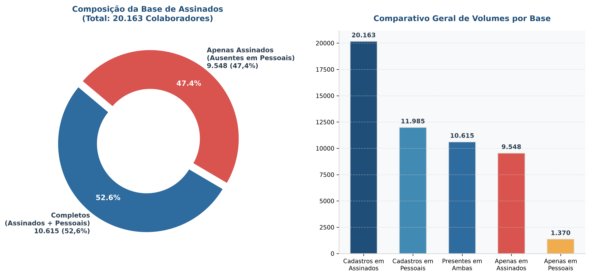

# Roover Python - Processador de Documentos e PDFs

Código em Python que compara duas planilhas na nuvem (Google Drive), faz um relacionamento de documentos entre duas pastas e salva em PDFs unificados por pessoa, além de gerar auditoria comparativa de cadastros.

---

## 📊 Distribuição dos Cadastros e Auditoria



> **Resumo da Auditoria:** Da base de **20.163** colaboradores com contratos assinados, **10.615 (52,6%)** possuem documentação completa de admissão digital e contratos. Os outros **9.548 (47,4%)** possuem contratos assinados arquivados, mas não constam na planilha de admissão (docs-pessoais), em sua grande maioria devido a admissões anteriores à implantação do sistema digital de onboarding. O relatório executivo formal e as planilhas consolidadas estão organizados na pasta [`docs/`](docs/).

---

## 🔒 Diretrizes de Segurança

* **Pasta de Origem (Apenas Leitura no Google Drive):**
  `G:\.shortcut-targets-by-id\11GxyE8SbWQbCXzoP8f3e9cGFfVK0TIFn\Roover`
  > **IMPORTANTE:** Nenhum arquivo ou pasta dentro do Drive `G:\` é modificado, criado ou apagado. O acesso é 100% de leitura.

* **Pasta de Destino (Local no Computador):**
  `C:\Users\hiurkiv\Documents\roover-python\`
  > Todos os scripts, dependências, arquivos processados e PDFs finais são salvos exclusivamente nesta pasta.

---

## 📁 Estrutura de Arquivos Locais

| Arquivo / Pasta | Descrição |
| :--- | :--- |
| **`reconciliar_bases.py`** | Script que lê as planilhas do Drive, cruza `CPF`, completa campos faltantes (`NOME`, `MATRICULA`) e salva a base unificada. |
| **`gerador_planilha_comparativa.py`** | Script de auditoria que compara `roover-docs-assinados` vs `roover-docs-pessoais`, gerando diagnóstico detalhado de inconsistências. |
| **`gerar_relatorio_word_e_graficos.py`** | Script que gera o gráfico analítico em PNG, o relatório formatado em Word (.docx) e o Markdown (.md). |
| **`gerador_pdf_pessoa.py`** | Script de consolidação de documentos e geração de PDFs (`{CPF}-{NOME}-roover.pdf`), com suporte a consultas individuais ou processamento em lote paralelo (multi-workers). |
| **`grafico_distribuicao_cadastros.png`** | Gráfico analítico de alta resolução em PNG (pizza e barras comparativas). |
| **`Relatorio_Comparativo_Auditoria.md`** | Relatório de auditoria em Markdown com diagramas Mermaid corrigidos e imagens. |
| **`Resultado de Auditoria.md`** | Registro de auditoria dos 21.146 PDFs unificados gerados no disco local. |
| **`docs/`** | Pasta que armazena os relatórios consolidados e planilhas executivas de saída. |
| ↳ **`docs/Relatorio_Comparativo_docs-roover.docx`** | Relatório executivo formal de auditoria em formato Word com tabelas e gráficos embutidos. |
| ↳ **`docs/comparativo_cadastros_assinados_vs_pessoais.xlsx`** | Planilha executiva comparativa com resumo executivo, cadastros apenas em assinados e apenas em pessoais. |
| ↳ **`docs/cadastros_apenas_em_assinados.xlsx`** | Planilha Excel dedicada apenas aos cadastros ausentes em admissão (com colunas pré-ajustadas). |
| ↳ **`docs/base_consolidada_roover.csv.xlsx`** | Planilha consolidada com 21.533 colaboradores, status de documentos e dados cruzados. |
| ↳ **`docs/relatorio_geracao.xlsx`** | Relatório gerado ao término do lote com o status individual, total de páginas, tamanho e tempo de cada PDF processado. |
| ↳ **`docs/lista_admissao.txt`** | Índice local com a lista de arquivos da pasta `arquivos-admissao` para busca instantânea sem gargalos de rede. |
| **`pdfs_gerados/`** | Pasta onde são salvos os arquivos PDF gerados. |
| **`.venv/`** | Ambiente virtual Python com `pandas`, `pypdf`, `Pillow`, `openpyxl`, `python-docx`, `matplotlib` instalados. |
| **`requerimentos.txt`** | Lista de pacotes Python instalados. |

---

## ⚡ Recursos da Geração em Lote

* **Processamento Paralelo (Multi-Worker):** Processa múltiplos cadastros simultaneamente (padrão de 4 workers em threads concorrentes).
* **Retomada Incremental Inteligente (Resume):** Detecta se o PDF da pessoa já foi gerado na pasta local. Se já existir, pula instantaneamente sem gastar banda de rede ou CPU, permitindo pausar e continuar a qualquer momento.
* **Gravação Atômica e Segura:** Cria os arquivos temporariamente como `.tmp` e só renomeia para `.pdf` após salvar por completo, impedindo arquivos corrompidos se a execução for interrompida.
* **Acompanhamento em Tempo Real:** Exibe contador `[X/Total]`, percentual de progresso, status do processamento, número de páginas e tamanho do arquivo.
* **Relatório Automático:** Registra ao final um arquivo CSV (`relatorio_geracao.csv`) para auditoria dos arquivos gerados, erros e registros sem documentos.

---

## 🚀 Como Executar

Abra o terminal (PowerShell ou CMD) na pasta `C:\Users\hiurkiv\Documents\roover-python`:

### 1. Geração em Lote (Toda a Base):

* **Iniciar processamento em lote da base inteira (4 workers padrão):**
  ```powershell
  .\.venv\Scripts\python.exe gerador_pdf_pessoa.py --todos
  ```

* **Testar com uma quantidade limitada de pessoas:**
  ```powershell
  .\.venv\Scripts\python.exe gerador_pdf_pessoa.py --todos --limite 20
  ```

* **Ajustar a quantidade de workers paralelos (ex: 6 workers):**
  ```powershell
  .\.venv\Scripts\python.exe gerador_pdf_pessoa.py --todos --workers 6
  ```

* **Forçar regeração de quem já foi processado:**
  ```powershell
  .\.venv\Scripts\python.exe gerador_pdf_pessoa.py --todos --sobrescrever
  ```

---

### 2. Geração Individual / Testes:

* **Gerar por CPF específico:**
  ```powershell
  .\.venv\Scripts\python.exe gerador_pdf_pessoa.py --cpf 12345678901
  ```

* **Gerar por Matrícula:**
  ```powershell
  .\.venv\Scripts\python.exe gerador_pdf_pessoa.py --matricula 77344
  ```

* **Modo Interativo (digitar no terminal):**
  ```powershell
  .\.venv\Scripts\python.exe gerador_pdf_pessoa.py
  ```

---

### 3. Reconciliação das Bases (se as planilhas do Drive forem atualizadas):
```powershell
.\.venv\Scripts\python.exe reconciliar_bases.py
```

### 4. Gerar Planilha Comparativa e Auditoria (Assinados vs Pessoais):
```powershell
.\.venv\Scripts\python.exe gerar_planilha_comparativa.py
```
