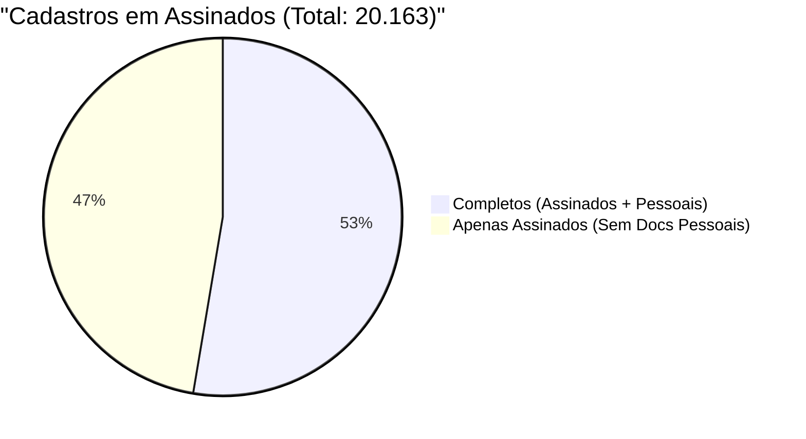

# Relatório de Auditoria Comparativa: Assinados vs Pessoais

> **Diretriz de Segurança:**  
> A pasta compartilhada no Google Drive (`G:\.shortcut-targets-by-id\...\Roover`) foi acessada em **modo estritamente de leitura**. Nenhum arquivo na nuvem foi modificado. Todas as planilhas e relatórios foram gerados localmente no repositório do projeto.

---

## 📌 1. Visão Geral da Análise

Durante a conferência dos PDFs gerados com a liderança, foi identificada a ausência de documentos pessoais/admissão para determinados colaboradores (como nos casos de admissões anteriores à digitalização).

Ao cruzar as duas fontes primárias do Google Drive:
1. `roover-docs-assinados.csv` (231.729 registros de contratos e termos assinados)
2. `roover-docs-pessoais.csv` (11.986 registros de documentos de admissão)

Foram identificados os totais consolidados de colaboradores (CPFs únicos) em cada situação:

### Gráfico Mermaid (Corrigido)

### Gráfico em Alta Resolução (PNG)

---

## 📊 2. Tabela de Métricas Consolidadas

| Métrica de Auditoria | Quantidade | Percentual / Detalhe | Status |
| :--- | :---: | :---: | :--- |
| **Total de Cadastros Únicos em Assinados** | **20.163** | 100,0% | Base total com contratos assinados |
| **Total de Cadastros Únicos em Pessoais** | **11.985** | — | Base de colaboradores com admissão digital |
| **Cadastros Presentes em AMBAS as Planilhas** | **10.615** | 52,6% | Possuem pasta de admissão e contratos assinados |
| **Cadastros APENAS em Assinados (Inconsistência)** | **9.548** | **47,4%** | **Constam em assinados mas NÃO em pessoais** |
| ↳ *Totalmente ausentes em pessoais (ex: Admissões históricas)* | 9.444 | 46,8% | Sem correspondência de CPF, Matrícula ou Nome |
| ↳ *Divergência de CPF (Mesma matrícula em pessoais)* | 42 | 0,2% | Matrícula idêntica, mas CPF divergente ou com erro de digitação |
| ↳ *Divergência de CPF (Mesmo nome em pessoais)* | 62 | 0,3% | Mesmo nome completo cadastrado com outro CPF |
| **Cadastros APENAS em Pessoais** | **1.370** | — | Colaboradores com admissão sem contratos assinados |

---

## 🔍 3. Análise Prática: O Exemplo de Admissões Históricas

Na planilha de contratos assinados (`roover-docs-assinados.csv`), constam **duas colaboradoras** com o primeiro nome Admissão Histórica:

| CPF | Matrícula | Nome Completo | Data Admissão | Qtd Docs Assinados | Presença em `docs-pessoais` |
| :---: | :---: | :--- | :---: | :---: | :--- |
| `11122233344` | `7421` | **COLABORADOR EXEMPLO A** | 01/08/2003 | 7 contratos | ❌ **Ausente** (não consta CPF, Matrícula nem Nome) |
| `55566677788` | `13117` | **COLABORADOR EXEMPLO B** | 25/11/2008 | 5 contratos | ❌ **Ausente** (não consta CPF, Matrícula nem Nome) |

### Motivo Técnico da Inconsistência
1. **Admissões Históricas:** Ambas foram admitidas há muitos anos (**2003** e **2008**), data muito anterior à digitalização do sistema de onboarding (`arquivos-admissao`).
2. **Ausência de Documentos Físicos Digitalizados:** Por não terem passado pelo processo eletrônico de admissão, não há pastas com prefixo `{ID_SISTEMICO}_` na nuvem.
3. **Assinaturas Eletrônicas Recentes:** Posteriormente, ambas assinaram termos e contratos eletrônicos, motivo pelo qual constam com 7 e 5 arquivos na planilha de assinados.
4. **Comportamento do Gerador:** O gerador de PDF agiu corretamente: unificou com sucesso todos os contratos assinados existentes, ficando apenas sem a seção de admissão.

---

## 🎯 4. Diagnóstico de Saneamento: Divergências de CPF (104 Casos)

Além dos colaboradores ausentes por admissão antiga, o cruzamento identificou **104 casos** onde o colaborador existe em ambas as planilhas, mas não se cruzavam automaticamente devido a divergências no CPF:

> [!TIP]
> **Exemplo Real Detectado:**  
> O colaborador **COLABORADOR EXEMPLO C** (Matrícula `75003`):  
> - Em `roover-docs-assinados`: CPF cadastrado como `11122233344`  
> - Em `roover-docs-pessoais`: CPF cadastrado como `11122233345` (diferença de apenas 1 dígito: 6 vs 5, ID Sistêmico `3296`)  
> 
> Todos esses casos foram sinalizados com status destacado em amarelo na planilha gerada, com o detalhe da matrícula e ID Sistêmico para que a equipe de RH/TI possa efetuar o saneamento cadastral.

---

## 🏆 5. Resultado da Geração e Auditoria da Base Total

| Categoria | Quantidade | Status |
| :--- | :---: | :--- |
| **Total de Colaboradores na Base** | **21.533** | 100% da base processada |
| **PDFs Finais Gerados no Disco** | **21.146** | **30,66 GB** consolidados e íntegros |
| **Sem Documentos no Google Drive** | **387** | Cadastros sem contrato nem fotos na nuvem |
| **Erros de Execução** | **0** | Nenhum arquivo corrompido ou travamento |
| **Casos Pendentes** | **0** | **100% concluído** |

> **Status do Projeto:**  
> Todos os colaboradores com documentação física disponível no Google Drive (**21.146 pessoas**) tiveram seus PDFs unificados gerados e validados na pasta local [`pdfs_gerados/`](pdfs_gerados/).

---

## 📁 6. Arquivos Gerados no Repositório

1. **Documento Formal em Word (.docx):**  
   [docs/Relatorio_Comparativo_docs-roover.docx](docs/Relatorio_Comparativo_docs-roover.docx)
2. **Planilha Excel Consolidada Oficial (3 Abas):**  
   [docs/comparativo_cadastros_assinados_vs_pessoais.xlsx](docs/comparativo_cadastros_assinados_vs_pessoais.xlsx)
3. **Gráfico em Alta Resolução (PNG):**  
   [grafico_distribuicao_cadastros.png](grafico_distribuicao_cadastros.png)
4. **Scripts de Auditoria Automatizados:**  
   [gerar_planilha_comparativa.py](gerar_planilha_comparativa.py) | [gerar_relatorio_word_e_graficos.py](gerar_relatorio_word_e_graficos.py)
